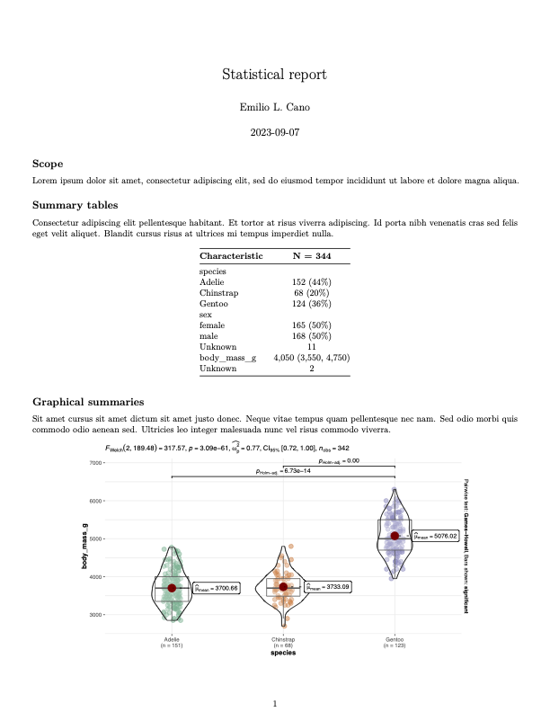
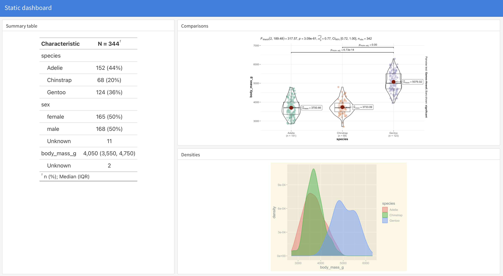
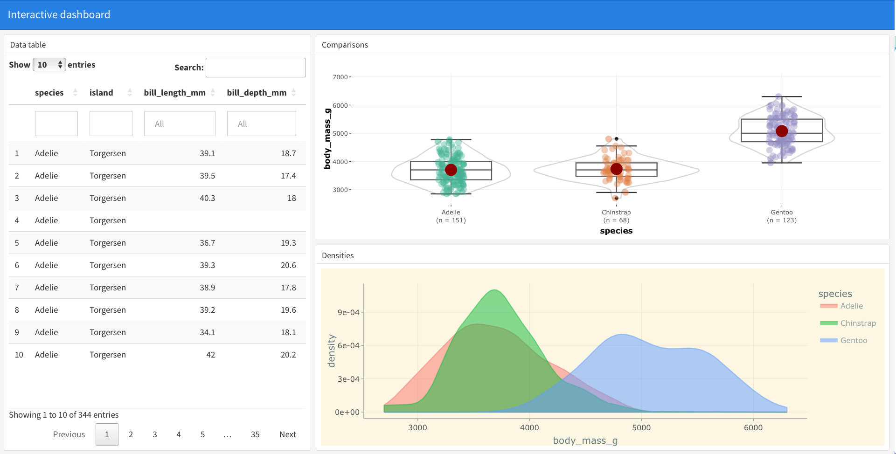

# Evolución de la visualización de datos 
  
## Informes estáticos
  
* Cuadro de mando integral: ejemplo clásico en la empresa

* Informes estadísticos: Normalmente resultados clave con gráficos, tablas e interpretación. Seleccionados por analista

* Por diseño, pensados para ser impresos en papel, formato [pdf]{.red}

[Descargar](http://emilio.lcano.com/p/enbis2023/static_report.Rmd) .Rmd source | [Ver online](http://emilio.lcano.com/p/enbis2023/static_report.pdf)

{fig-align=center, width=420}
  
## Dashboards estáticos
  
Más compactos, diseñado para pantalla


[Descargar](http://emilio.lcano.com/p/enbis2023/static_dashboard.Rmd) .Rmd source | [Ver online](http://emilio.lcano.com/p/enbis2023/static_dashboard.html)
  
{fig-align=center}

## Dashboards interactivos
  
Informe estático con elementos interactivos (_widgets_)

[Descargar](http://emilio.lcano.com/p/enbis2023/interactive_dashboard.Rmd) .Rmd source | [Ver online](http://emilio.lcano.com/p/enbis2023/interactive_dashboard.html)
  
{fig-align=center}

## Limitaciones y alternativas
  
* Limitados a lo que el estadístico quiere mostrar

* No solo lo van a usar personas expertas en estadística

* Toma de decisiones a distintos niveles

* Aplicaciones **Reactivas** guían a las partes interesadas en la obtención e interpretación de resultados


# Aplicaciones reactivas

## _Reactive programming_

>The key idea of reactive programming is to specify a graph of dependencies so that when an input changes, all related outputs are automatically updated.
>
  
_Hadley Wickham, [Mastering Shiny](https://mastering-shiny.org/basic-reactivity.html)_
  

Los **outputs**, i.e., gráficos, tablas, etc., se generan con R cuando los **inputs**, i.e., selecciones del usuario, cambian.

## Aplicaciones Shiny


* Código "estándar" de R

* No hace falta nada más, todo el código HTML, CSS y JS se genera automáticamente

* Dos "componentes"

* `ui` (interfaz de usuario, página web). Contiene _inputs_ y _outputs_

* `server`. Contiene objetos _reactivos_ y funciones [generadoras]{.red} (_rendering_)


- [Descargar](https://shiny.posit.co/r/articles/start/cheatsheet/) Shiny _cheetsheet_

- [Visitar](https://shiny.posit.co/r/gallery/) la _Shiny gallery_

  

{fig-align=center width="140"}

  
## Una aplicación shiny simple
  

```{r}
#| label: shinypenguins
#| eval: false
#| echo: true
library(shiny)
library(palmerpenguins)
library(plotly)
library(ggplot2)
ui <- fluidPage(
  title = "Simple demo app",
  sidebarLayout(
    sidebarPanel(
      varSelectInput(
        "varx",
        "Explanatory variable",
        penguins |> select(where(is.numeric))
      ),
      varSelectInput(
        "vary",
        "Response variable",
        penguins |> select(where(is.numeric))
      ),
      varSelectInput(
        "varcol",
        "Colour variable",
        penguins |> select(where(is.factor))
      )
    ),
    mainPanel(
      plotlyOutput("plot"),
      verbatimTextOutput("model")
    )
  )
)
server <- function(input, output, session) {
  output$plot <- renderPlotly({
    p <- penguins |>
      ggplot(aes_string(x = input$varx, y = input$vary, col = input$varcol)) +
      geom_point()
    ggplotly(p)
  })
  output$model <- renderPrint({
    m <- lm(get(input$vary) ~ get(input$varx) + get(input$varcol), penguins)
    summary(m)
  })
}
shinyApp(ui = ui, server = server)
```

  
🖥️ Live demo 🤞🏻


  
# Aplicación shiny para datos ISTAC paso a paso
  
## Caso de uso
  
* Gráficos interactivos

* Tablas interactivas

* Mapas

* Datos de población


💡 Se extiende fácilmente para otros datos y paquetes

## Configuración inicial

1. Crear un proyecto en RStudio.

2. Instalar paquetes shiny, bslib, leaflet, plotly, gt.

3. Crear script vacío.

4. Insertar estructura ui + server (por ejemplo con el _snippet_) 

5. Ir añadiendo el código de los ejemplos de esta presentación (o copiándolo entero, cada ejemplo es autocontenido)

## Estructura básica app shiny

Este código crea la estructura básica con el `ui` y el `server` vacíos.

```{r}
#| eval: false
#| echo: true
library(shiny)

ui <- fluidPage()

server <- function(input, output, session) {}

shinyApp(ui, server)
```

## Disposición del _dashboard_ (_layout_)

* [bslib](https://rstudio.github.io/bslib/articles/dashboards/) tiene muchas opciones

Lo básico sería añadir un título, una barra lateral con su título, y un par de paneles para un gráfico y una tabla. Los paneles son un tipo de contenedor, donde iremos colocando _inputs_ y _outputs_

```{r}
#| eval: false
#| echo: true
library(shiny)
library(bslib)

ui <- page_navbar(
  title = "Visualización de datos de población del ISTAC",
  sidebar = sidebar(title = "Selección"),
  nav_panel(title = "Población por sexos"),
  nav_panel(title = "Evolución temporal")
)

server <- function(input, output, session) {}

shinyApp(ui, server)
```

## Añadiendo _inputs_ y _outputs_ al _ui_

En el UI añadimos, dentro del contenedor adecuado, controles para seleccionar (nputs) y controles donde se mostrarán los resultados (outputs). Esto se hace mediante funciones `xxxInput()` y `xxxOutput()`. Véase la _cheatsheet_ para un resumen de los más habituales.

```{r}
#| eval: false
#| echo: true
#| code-line-numbers: "9-17,20-21,23"
library(shiny)
library(bslib)
library(gt)
library(plotly)
ui <- page_navbar(
  title = "Visualización de datos de población del ISTAC",
  sidebar = sidebar(
    title = "Selección",
    selectInput("sexo", "Sexo", c("Hombres", "Mujeres", "Total")),
    sliderInput(
      "intervalos",
      "Intervalos para el histograma",
      min = 4,
      max = 30,
      value = 8,
      step = 1
    ),
    selectInput("medida", "Medida", c("Media", "Mediana"))
  ),
  nav_panel(
    title = "Población por sexos",
    gt_output("tabla_poblacion"),
    plotlyOutput("histograma_poblacion")
  ),
  nav_panel(
    title = "Evolución temporal",
    gt_output("tabla_evolucion"),
    plotlyOutput("grafico_evolucion")
  )
)

server <- function(input, output, session) {}

shinyApp(ui, server)
```


💡 Hemos creado los contenedores para los outputs, pero están vacíos.

⚠️ El primer argumento de los controles es el `id`, a través del cual se accede a su valor.

## Añadiendo objetos reactivos

En el siguiente ejemplo, cargamos los datos a nivel de aplicación (los mismos datos que usamos en el taller básico).

Un objeto reactivo depende de los valores de los _inputs_. Cada vez que se cambia un _input_ que le afecta, se actualiza. Los objetos reactivos se utilizan habitualmente para renderizar outputs como veremos después. En este ejemplo obtenemos los datos filtrados según la selección. Con la función `req()` controlamos que no haya errores por falta de _inputs_.

```{r}
#| eval: false
#| echo: true
#| code-line-numbers: "25-32"
library(shiny)
library(bslib)
library(gt)
library(readr)
library(dplyr)
library(plotly)
edad_canarias <- read_tsv(
  "datos/dataset-ISTAC-E30243A_000014.tsv"
)

ui <- page_navbar(
  title = "Visualización de datos de población del ISTAC",
  sidebar = sidebar(
    title = "Selección",
    selectInput("sexo", "Sexo", c("Hombres", "Mujeres", "Total")),
    sliderInput(
      "intervalos",
      "Intervalos para el histograma",
      min = 4,
      max = 30,
      value = 8,
      step = 1
    ),
    selectInput("medida", "Medida", c("Edad media", "Edad mediana"))
  ),
  nav_panel(
    title = "Población por sexos",
    gt_output("tabla_poblacion"),
    plotlyOutput("histograma_poblacion")
  ),
  nav_panel(
    title = "Evolución temporal",
    gt_output("tabla_evolucion"),
    plotlyOutput("grafico_evolucion")
  )
)

server <- function(input, output, session) {
  datos <- reactive({
    req(input$sexo, input$medida)
    edad_canarias |>
      filter(
        SEXO == input$sexo,
        MEDIDAS == input$medida,
        LUGAR_NACIMIENTO == "Total"
      )
  })
}

shinyApp(ui, server)
```


🎯 Fíjate como se usan los `id` de los inputs para acceder a sus valores

## Renderizando _outputs_

Ahora sí, vamos a generar los outputs dentro de `server`. Cada función `xxxOutput` (o `xxx_output()` en algunos paquetes como {gt}) tiene una función equivalente `renderXxxx()` (o `render_xxx`). Fíjate cómo se usa el objeto reactivo, añadiendo paréntesis al final del nombre. Añadimos también un par de inputs para filtrar los datos de forma adecuada. 

💡 Vamos a añdir interactividad a los gráficos. Una forma muy sencilla es convertir un gráfico `ggplot2` a `plotly` con la función `ggplotly()`.


```{r}
#| eval: false
#| echo: true
#| code-line-numbers: "34-43"
library(shiny)
library(bslib)
library(gt)
library(readr)
library(dplyr)
library(ggplot2)
library(plotly)
edad_canarias <- read_tsv(
  "datos/dataset-ISTAC-E30243A_000014.tsv"
)

ui <- page_navbar(
  title = "Visualización de datos de población del ISTAC",
  sidebar = sidebar(
    title = "Selección",
    selectInput("sexo", "Sexo", c("Hombres", "Mujeres", "Total")),
    sliderInput(
      "intervalos",
      "Intervalos para el histograma",
      min = 4,
      max = 30,
      value = 8,
      step = 1
    ),
    selectInput("medida", "Medida", c("Edad media", "Edad mediana")),
    sliderInput("anio", "Año", 2021, 2025, 2025),
    selectInput("territorio", "Territorio", choices = unique(edad_canarias$TERRITORIO))
  ),
  nav_panel(
    title = "Población por sexos",
    gt_output("tabla_poblacion"),
    plotlyOutput("histograma_poblacion")
  ),
  nav_panel(
    title = "Evolución temporal",
    gt_output("tabla_evolucion"),
    plotlyOutput("grafico_evolucion")
  )
)

server <- function(input, output, session) {
  datos <- reactive({
    req(input$sexo, input$medida, input$territorio)
    edad_canarias |>
      filter(
        SEXO == input$sexo,
        MEDIDAS == input$medida,
        LUGAR_NACIMIENTO == "Total",
        TIME_PERIOD == input$anio
      )
  })

    
  output$tabla_poblacion <- render_gt({
    datos() |>
      gt()
  })
  output$histograma_poblacion <- renderPlotly({
    p <- datos() |>
      ggplot(aes(x = OBS_VALUE)) +
      geom_histogram(bins = input$intervalos, fill = "gold", col = "white")
    ggplotly(p)
  })
}

shinyApp(ui, server)
```


## Dale color - ver cómo queda un tema

```{r}
#| eval: false
#| echo: true
#| code-line-numbers: "26"
library(shiny)
library(bslib)
library(gt)
library(readr)
library(dplyr)
library(ggplot2)
library(plotly)
edad_canarias <- read_tsv(
  "datos/dataset-ISTAC-E30243A_000014.tsv"
)

ui <- page_navbar(
  title = "Visualización de datos de población del ISTAC",
  sidebar = sidebar(
    title = "Selección",
    selectInput("sexo", "Sexo", c("Hombres", "Mujeres", "Total")),
    sliderInput(
      "intervalos",
      "Intervalos para el histograma",
      min = 4,
      max = 30,
      value = 8,
      step = 1
    ),
    selectInput("medida", "Medida", c("Edad media", "Edad mediana")),
    sliderInput("anio", "Año", 2021, 2025, 2025),
    selectInput("territorio", "Territorio", choices = unique(edad_canarias$TERRITORIO))
  ),
  nav_panel(
    title = "Población por sexos",
    gt_output("tabla_poblacion"),
    plotlyOutput("histograma_poblacion")
  ),
  nav_panel(
    title = "Evolución temporal",
    gt_output("tabla_evolucion"),
    plotlyOutput("grafico_evolucion")
  )
)

server <- function(input, output, session) {
  bs_themer()
  datos <- reactive({
    req(input$sexo, input$medida, input$territorio)
    edad_canarias |>
      filter(
        SEXO == input$sexo,
        MEDIDAS == input$medida,
        LUGAR_NACIMIENTO == "Total",
        TIME_PERIOD == input$anio
      )
  })

    
  output$tabla_poblacion <- render_gt({
    datos() |>
      gt()
  })
  output$histograma_poblacion <- renderPlotly({
    p <- datos() |>
      ggplot(aes(x = OBS_VALUE)) +
      geom_histogram(bins = input$intervalos, fill = "gold", col = "white")
    ggplotly(p)
  })
}

shinyApp(ui, server)
```

## Dale color - configura el tema

```{r}
#| eval: false
#| echo: true
#| code-line-numbers: "6"


library(shiny)
library(bslib)
library(gt)
library(readr)
library(dplyr)
library(ggplot2)
library(plotly)
edad_canarias <- read_tsv(
  "datos/dataset-ISTAC-E30243A_000014.tsv"
)

ui <- page_navbar(
  theme = bs_theme(bootswatch = "minty"),
  title = "Visualización de datos de población del ISTAC",
  sidebar = sidebar(
    title = "Selección",
    selectInput("sexo", "Sexo", c("Hombres", "Mujeres", "Total")),
    sliderInput(
      "intervalos",
      "Intervalos para el histograma",
      min = 4,
      max = 30,
      value = 8,
      step = 1
    ),
    selectInput("medida", "Medida", c("Edad media", "Edad mediana")),
    sliderInput("anio", "Año", 2021, 2025, 2025),
    selectInput("territorio", "Territorio", choices = unique(edad_canarias$TERRITORIO))
  ),
  nav_panel(
    title = "Población por sexos",
    gt_output("tabla_poblacion"),
    plotlyOutput("histograma_poblacion")
  ),
  nav_panel(
    title = "Evolución temporal",
    gt_output("tabla_evolucion"),
    plotlyOutput("grafico_evolucion")
  )
)

server <- function(input, output, session) {
  datos <- reactive({
    req(input$sexo, input$medida, input$territorio)
    edad_canarias |>
      filter(
        SEXO == input$sexo,
        MEDIDAS == input$medida,
        LUGAR_NACIMIENTO == "Total",
        TIME_PERIOD == input$anio
      )
  })

    
  output$tabla_poblacion <- render_gt({
    datos() |>
      gt() |> 
      opt_interactive()
  })
  output$histograma_poblacion <- renderPlotly({
    p <- datos() |>
      ggplot(aes(x = OBS_VALUE)) +
      geom_histogram(bins = input$intervalos, fill = "gold", col = "white")
    ggplotly(p)
  })
}

shinyApp(ui, server)


```


# Ejercicios

1. Añade gráfico temporal filtrando por territorio para todos los años.

2. Añade un mapa de Canarias con los territorios coloreados según la media o mediana de edad.

3. Crea una aplicación desde cero utilizando tu herramienta de IA generativa favorita. 


# Preguntas? 

`❓ [@emilopezcano](https://x.com/emilopezcano)


[http://lcano.com](https://lcano.com)

[emilio.lopez@urjc.es]{.red}

\

¡Gracias!
  
:::{style="text-align:center"}
🖥️ Live demo 🤞🏻
:::
  
  
  